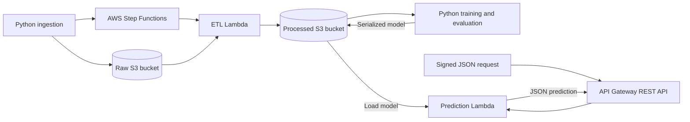

# Iris data integration and prediction on AWS

This project ingests the public Iris dataset, cleans it in an AWS Lambda function, trains a multiclass scikit-learn model, and serves species predictions through Amazon API Gateway.



## Implementation

1. **Extract and upload.** `run_pipeline.py` loads the 150 public Iris observations bundled with scikit-learn and writes a CSV with four measurements in centimeters plus the species label. In cloud mode it uploads this CSV to the private raw S3 bucket under a unique `raw/iris-*.csv` key. [Dataset documentation](https://scikit-learn.org/stable/modules/generated/sklearn.datasets.load_iris.html)
2. **Orchestrate and transform.** After upload succeeds, the script starts an AWS Step Functions Standard execution. Step Functions coordinates ETL in place of Glue because this small CSV fits in one Lambda invocation. Lambda checks the header, parses measurements, normalizes species labels, drops invalid and duplicate rows, and writes canonical CSV to the processed bucket. Step Functions retries transient Lambda service errors and returns counts and the processed object key. A retry writes the same content to the same logical key. [Step Functions Lambda integration](https://docs.aws.amazon.com/step-functions/latest/dg/connect-lambda.html)
3. **Train and serialize.** The Python runner downloads the processed CSV and compares it against the expected output. It uses a stratified 80/20 split with seed 42 and fits a `StandardScaler` and multinomial logistic regression on the training partition. It serializes the fitted scaler and classifier parameters as `iris.json`, evaluates the held-out observations, and checks that the serialized model reproduces scikit-learn's labels and probabilities. It uploads the artifact to `models/iris.json` in the processed bucket and reads it back to verify the bytes.
4. **Serve and verify.** API Gateway exposes IAM-authenticated `POST /prod/predict`. Prediction Lambda reads the current artifact from S3 and applies the saved scaler, linear scores, and softmax. The response includes the top species, probabilities for all three classes, and a model ID derived from the fitted parameters. The runner makes signed HTTPS requests and verifies that the endpoint serves the uploaded model, predicts the expected species, and rejects invalid input. [API Gateway IAM authorization with SAM](https://docs.aws.amazon.com/serverless-application-model/latest/developerguide/serverless-controlling-access-to-apis-permissions.html)

## Run locally

Use Python 3.12. From the project directory in PowerShell:

```powershell
python -m venv .venv
.\.venv\Scripts\python.exe -m pip install -r requirements.txt
.\.venv\Scripts\python.exe run_pipeline.py
```

The local run invokes the ETL handler against a deliberately dirty fixture with mocked S3 calls, trains on the cleaned public dataset, tests parity with scikit-learn, and calls the actual prediction handler with an in-memory model. It saves `artifacts/iris.json` and `artifacts/validation.json`. It requires no AWS session.

## Deploy and run on AWS

Use an active AWS CLI profile with CloudFormation deployment, IAM role creation and passing, S3, Lambda, Step Functions, and API Gateway permissions. The runner needs stack output access, S3 read/write on its data prefixes, permission to start and describe the state machine execution, and `execute-api:Invoke` for the prediction route. For a named profile, set `$env:AWS_PROFILE` before deploying and use the same profile for the Python scripts.

```powershell
aws sts get-caller-identity --region us-east-1
.\deploy.ps1 -Stack iris-pipeline -Region us-east-1
.\.venv\Scripts\python.exe run_pipeline.py --stack iris-pipeline --region us-east-1 --output artifacts/aws
```

`deploy.ps1` packages the two handlers into an account-and-region S3 staging bucket, validates the packaged template with CloudFormation, and deploys the stack. The script prints the bucket names, state machine ARN, and prediction URL. The prediction endpoint starts serving after the first successful model upload. A cloud run records the execution ARN, S3 object keys, held-out metrics, and endpoint checks in `artifacts/aws/validation.json`.

To rerun only the API checks, use the stack endpoint and the artifact from the cloud run.

```powershell
$predictionUrl = aws cloudformation describe-stacks --stack-name iris-pipeline --region us-east-1 --query "Stacks[0].Outputs[?OutputKey=='PredictionUrl'].OutputValue | [0]" --output text
.\.venv\Scripts\python.exe test_api.py --url $predictionUrl --model artifacts/aws/iris.json --region us-east-1
```

Example request body:

```json
{
  "sepal_length_cm": 5.1,
  "sepal_width_cm": 3.5,
  "petal_length_cm": 1.4,
  "petal_width_cm": 0.2
}
```

The route returns HTTP 200 for valid measurements, HTTP 400 for invalid request bodies, and HTTP 503 if the model cannot be loaded or evaluated. Requests need SigV4 signing. The two Python scripts apply it using the configured AWS credentials.

## Verified results

| Check | Observed result |
|---|---:|
| Raw observations | 150 |
| Invalid rows in the source dataset | 0 |
| Exact duplicates removed | 1 |
| Cleaned observations | 149 |
| Training / test observations | 119 / 30 |
| Held-out accuracy | 93.3% |
| Held-out macro F1 | 0.933 |
| Valid test prediction | Setosa, 98.16% probability |
| Invalid requests rejected by the live API | 6 / 6 |

The deployed stack `iris-pipeline` reached `CREATE_COMPLETE` in `us-east-1`. The end-to-end cloud run and the standalone signed HTTPS test both passed. The [cloud validation report](artifacts/aws/validation.json) records the successful Step Functions execution, S3 object keys, held-out metrics, and API response. The [model artifact](artifacts/aws/iris.json) matches the version served by Lambda.

The confusion matrix contains one versicolor predicted as virginica and one virginica predicted as versicolor. The small held-out sample makes this an assignment demonstration of the pipeline, with limited evidence for performance beyond the Iris dataset.

## Implementation challenges

- **Data leakage.** The cleaner removes exact duplicate rows before splitting. scikit-learn fits scaling only on the training partition, so held-out measurements do not influence scaling.
- **Training and scoring parity.** The scorer uses only the Python standard library for the model math, while training uses scikit-learn. The runner checks that both implementations agree on labels and probabilities across the entire test split after JSON serialization. This keeps native scientific packages out of the Lambda deployment.
- **Artifact freshness.** Prediction Lambda reads the current S3 model on each request. The smoke test compares the returned model ID with the uploaded artifact. Sequential cloud runs are supported. A later publication replaces the current serving model, and S3 versioning retains earlier artifacts.
- **Authentication.** The initial browser sign-in returned HTTP 400. The AWS CLI remote sign-in flow renewed the session and allowed deployment. The first signed API check immediately after stack creation returned 403. A later signed request reached Lambda, and the full cloud run and standalone API test passed on retry without an infrastructure change.

If ETL fails, inspect the execution in Step Functions and the transform function logs in CloudWatch. If the API returns 403, check the active profile, region, and invoke permission. For HTTP 503, confirm that `models/iris.json` exists in the processed bucket and check the prediction function logs.

## Cleanup

Delete the CloudFormation stack when the demonstration is complete. The template retains both versioned data buckets. The separate staging bucket also persists. To remove retained storage, first identify the exact bucket names from the stack outputs, then delete the intended objects and versions before deleting those buckets. AWS usage and stored objects may incur charges.
